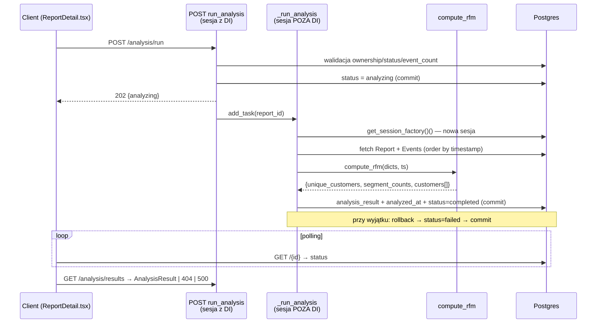

# Research — Przepływ analizy RFM (M4L3, Deep Focus)

> **Cel:** badam przepływ uruchomienia analizy RFM (`POST /api/reports/{id}/analysis/run`
> → BackgroundTask → `compute_rfm` → zapis → `GET /analysis/results`), zaczynając od
> `routers/analysis.py`, bo `context/map/repo-map.md` wskazał ten obszar jako strefę ryzyka
> #1 (sesja poza DI, coupling 4 plików). Wyłącznie analiza stanu obecnego — bez refaktoru.
>
> Metoda: 3 równoległe sub-agenty (trace e2e / luki w testach / blast radius) + ręczna
> weryfikacja twierdzeń strukturalnych grepem (`ast-grep` niedostępny w środowisku; przy
> ~2000 liniach kodu grep daje ten sam sygnał — patrz §Weryfikacja).

---

## ② Feature overview

Przepływ jest **dwufazowy i asynchroniczny**. Faza synchroniczna (HTTP) waliduje i
przełącza status; faza asynchroniczna (BackgroundTask) liczy i zapisuje wynik; frontend
pollem odpytuje o status i dopiero potem pobiera wynik.

**Skąd wchodzą dane, gdzie zmienia się stan, co wraca:**

1. **`POST /{report_id}/analysis/run`** (`routers/analysis.py:92-129`) — sesja z DI
   (`Depends(get_db)`). Waliduje: ownership (`Report.user_id == current_user.sub`, :103-109 →
   404), niezakończoną analizę (`status == analyzing` → 409, :113-117), niepusty raport
   (`event_count == 0` → 400, :119-123). Przy sukcesie ustawia `status = analyzing`,
   commituje (:125-126) i enqueuuje `background_tasks.add_task(_run_analysis, report_id)`
   (:127). Zwraca **202** `{"status": "analyzing"}`.

2. **`_run_analysis(report_id)`** (`routers/analysis.py:41-84`) — **otwiera NOWĄ sesję poza
   DI**: `async with get_session_factory()() as db:` (:42). Pobiera raport (:44), eventy
   posortowane po `timestamp` (:49-54), mapuje na `list[dict]` (:57-65), woła
   `compute_rfm(event_dicts, analysis_ts)` (:67), zapisuje `analysis_result` + `analyzed_at`
   + `status = completed` i commituje (:69-72). Na wyjątku: rollback → ponowny fetch →
   `status = failed` → commit (:74-82).

3. **`compute_rfm(events, analysis_ts)`** (`services/rfm.py:30-128`) — czysta funkcja
   (tylko stdlib). Agreguje per klient (`latest_date`, `frequency`, `monetary` — monetary
   tylko z `event_type == "purchase"`, :60-62), liczy kwintyle (`_cutpoints` →
   `statistics.quantiles(n=5)`), skoruje R/F/M w 1–5, przypisuje segment regułami
   priorytetowymi (pierwsza pasująca wygrywa, `_SEGMENT_RULES` :7-14). Zwraca dict:
   `{unique_customers, segment_counts, customers[]}`. Przypadki brzegowe: pusty zbiór
   (:37-42), jeden klient (wszystkie score = 3, segment Others, :68-85).

4. **`GET /{report_id}/analysis/results`** (`routers/analysis.py:132-164`) — sesja z DI.
   Ownership (:142-150 → 404), brak wyniku → 404 „run analysis first" (:152-156), walidacja
   `AnalysisResult(**report.analysis_result)` → przy `ValidationError` **500** „corrupted"
   (:158-164). Frontend osobno pollem odpytuje `GET /{report_id}` o `status`.

---

## ③ Technical debt

Trzy klasy długu, uszeregowane wg ryzyka. Każda odsyła do już zdefiniowanych ryzyk z
`context/foundation/test-plan.md`.

### D1 — Ścieżka awarii analizy nieprzetestowana i „niema" (Risk #6, HIGH)
- **Dowód:** `routers/analysis.py:74-84` ustawia `status = failed`, ale **żaden test nie
  wymusza wyjątku w `compute_rfm`** — potwierdzają to trzy niezależne obserwacje (sub-agent
  „luki w testach" GAP #1/#2 + brak jakiegokolwiek mocka rzucającego w `test_analysis.py`).
- **Zagnieżdżony `except` (:83-84) połyka błąd** — jeśli sam zapis `failed` padnie (utrata
  połączenia), raport zostaje **na zawsze w `analyzing`** (zombie). Nietestowalne bez
  wstrzyknięcia awarii.
- **`GET /results` myli dwa stany:** brak wyniku i po-awarii zwracają identyczne
  404 (:152-156). Frontend nie odróżni „jeszcze nie uruchomiono" od „analiza padła" — co
  bezpośrednio karmi objaw z `impl-review-phase-3.md` (user utknięty na „Analyzing…").
- **Blast radius:** naprawa dotyka `analysis.py` (kontrakt błędu) + `ReportStatus` +
  `ReportDetail.tsx` (UI stanu `failed`) — szew backend↔frontend.

### D2 — Oracle RFM: integracja sprawdza zakresy, nie wartości; segmenty pokryte częściowo (Risk #2, HIGH)
- **Dowód:** `test_results_correctness` (`test_analysis.py:212-233`) asertuje wyłącznie
  **zakresy** (`1 <= r_score <= 5`) i jeden niezmiennik (Champions ⇒ R≥4 ∧ F≥4). Dokładne
  wartości pilnuje warstwa unit (`test_rfm_algorithm.py`, 11 testów).
- **Priorytet reguł segmentów jest testowany implicytnie, nie wprost:** fixture'y używają
  „czystych" klientów (score 5/5/5, 4/4/4…). Brak przypadku granicznego typu R=3,F=4,M=4,
  który rozstrzyga *pierwszeństwo* Loyal vs Others.
- **Segmenty pokryte przypisaniem: 3 z 6.** Wszystkie 6 nazw są sprawdzane jako *klucze*
  (`test_normal_fixture_all_six_segments_present_as_keys`, :84-88), ale realne *przypisanie
  klienta* ćwiczą tylko **Champions, Others, Hibernating**; At Risk / Loyal Customers /
  Potential Loyalists występują wyłącznie w asercji „klucz istnieje" (weryfikacja grepem,
  §niżej — koryguje twierdzenie sub-agenta „3/6 reachable" do precyzyjniejszej formy).
- **Ryzyko wyroczni:** dopóki nowe testy segmentów biorą oczekiwane wartości z niezależnego
  wyliczenia wg PRD §Business Logic (a nie z uruchomienia `compute_rfm`), test ma sens;
  inaczej stanie się tautologią (test-plan.md Risk #2 guidance).

### D3 — Ciasny, ręcznie zduplikowany kontrakt wyniku backend↔frontend (dług strukturalny, MEDIUM)
- **Dowód:** kształt wyniku RFM zdefiniowany 3×: `compute_rfm` return (`services/rfm.py:124-128`),
  Pydantic `AnalysisResult`/`CustomerResult` (`routers/analysis.py:20-34`), TS
  `AnalysisResult`/`CustomerResult` (`frontend/src/types/report.ts`). 8 pól `CustomerResult`
  × 2 języki = ręczna synchronizacja bez wspólnego źródła.
- **Segmenty zduplikowane:** `_SEGMENT_NAMES`/`_SEGMENT_RULES` w Pythonie (`services/rfm.py:7-16`)
  vs `SEGMENT_ORDER` we froncie (`ReportDetail.tsx:6`, użyty w :256 i :416). Dodanie segmentu
  = zmiana w obu, bez mechanizmu wykrywającego rozjazd.
- **`analysis_result` to schemabless JSONB** (`models/report.py:39`; migracja
  `alembic/.../add_analysis_result_column`, kolumna bez constraintów) — zmiana kształtu **nie
  wymaga migracji**, ale też **nic nie chroni** starych rekordów; jedyna linia obrony to
  `ValidationError → 500` przy odczycie (`analysis.py:158-164`).
- **Skala sprzężenia:** hipotetyczna zmiana jednego pola wyniku ⇒ ~8–12 zmian (rfm.py,
  analysis.py ×2 schematy, types.ts, ReportDetail.tsx render + kolumny, testy unit +
  integration). Nie jest to defekt — to koszt zmiany, który plan refaktoru (M4L4) musi znać.

### Dług tani (łapany gdzie indziej, nie priorytet)
- Eventy dodane *w trakcie* analizy są pomijane (`all()` snapshot, :54) — edge case,
  BackgroundTasks bez kolejki. Zachowanie przy restarcie procesu w trakcie analizy: **UNKNOWN**.
- Brak retry/timeout dla `compute_rfm`; brak `pool_size` — obszar observability, nie testu.

---

## Weryfikacja twierdzeń strukturalnych (grep zamiast ast-grep)

| Twierdzenie | Źródło | Werdykt | Dowód |
|---|---|---|---|
| „`test_rfm_algorithm.py` ma 28 testów" | sub-agent blast radius | **OBALONE** → 11 | `grep -c "def test"` = 11 |
| „`test_analysis.py` ma 10 testów" | sub-agent trace/testy | **DOPRECYZOWANE** → 9 funkcji | `grep -c "def test"` = 9 |
| „6 reguł segmentów" | sub-agent trace | **POTWIERDZONE** | `grep -c lambda services/rfm.py` = 6 |
| „segmenty zduplikowane w TS" | sub-agent blast radius | **POTWIERDZONE** | `SEGMENT_ORDER` w `ReportDetail.tsx:6,256,416` |
| „tylko 3/6 segmentów osiągalnych" | sub-agent testy | **DOPRECYZOWANE** | wszystkie 6 jako klucze (:86); przypisanie klienta tylko Champions/Others/Hibernating |

> Zasada z lekcji: liczby liczone precyzyjnie, każde „zero"/liczba potwierdzone grepem.
> `ast-grep` niedostępny — przy tej skali repo grep po nazwach symboli daje równoważny sygnał.

## EVIDENCE / INFERENCE / UNKNOWN

- **EVIDENCE:** wszystkie file:line powyżej pochodzą z odczytanego kodu i zweryfikowanych
  komend grep/git.
- **INFERENCE:** ścieżka `failed` nigdy nie wykonuje się w testach; priorytet segmentów
  poprawny, ale nie zweryfikowany na granicy; zmiana kształtu wyniku ⇒ 8–12 zmian.
- **UNKNOWN:** zachowanie przy restarcie procesu w trakcie analizy; czy deploy łapie logi
  wyjątków; komunikat, jaki realnie widzi użytkownik po awarii.

---

## Wejście do M4L4

Najlepszy kandydat do „jednej bezpiecznej zmiany": **D1** (widoczny stan `failed` +
odróżnienie w `GET /results`) — najwyższe ryzyko (HIGH), mapuje na Risk #6, wąski blast
radius, testowalny przez wstrzyknięcie awarii `compute_rfm`. D2 to raczej materiał na fazę
testową (test-plan.md Phase 3), a D3 to dług strukturalny na osobny, większy cykl.
