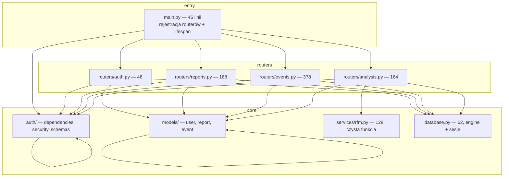
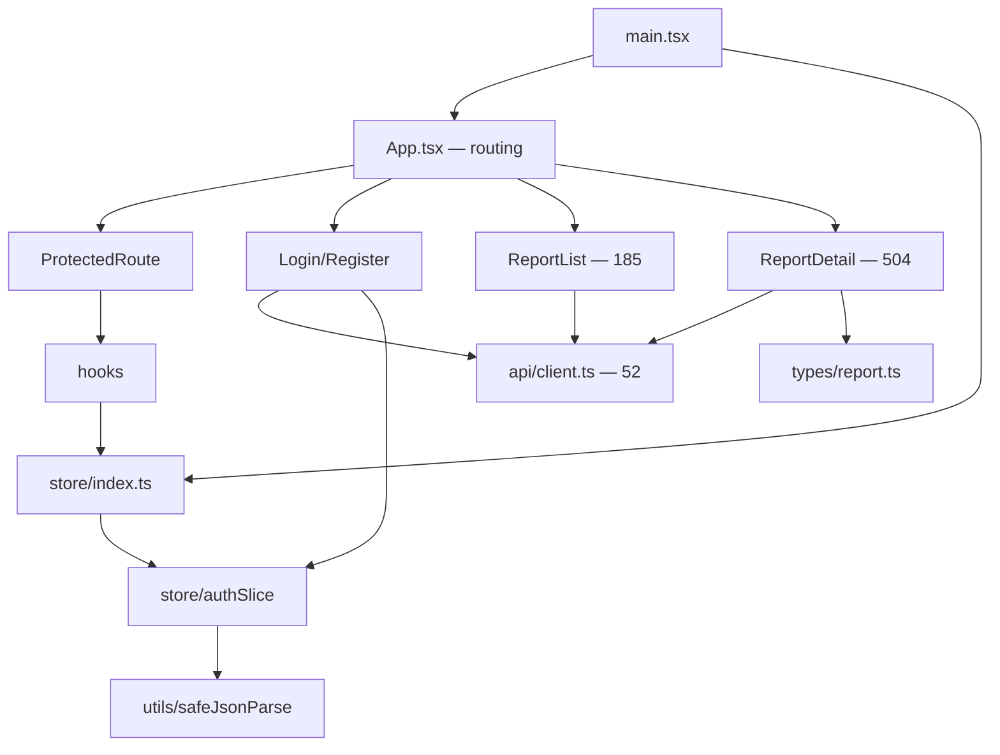

# Artifact 2 — Structure: co realnie zależy od czego

> Metoda: analiza importów (grep po `from X import` w backendzie, importy względne we froncie)
> + rozmiary plików jako proxy gęstości. Repo małe (~2000 linii kodu produktu), graf policzalny ręcznie.

## Backend — graf warstw

**Cykli brak.** Zależności płyną w jedną stronę: `main → routers → {auth, models, services, database}`.

## Kluczowe obserwacje strukturalne

1. **`services/rfm.py` jest czystym rdzeniem** — importuje tylko stdlib (`decimal`, `statistics`, `datetime`), przyjmuje `list[dict]`, nie zna ORM ani FastAPI. Najlepiej odizolowany moduł w repo; testowalny bez bazy (i tak jest testowany — `tests/test_rfm_algorithm.py`).
2. **`routers/analysis.py` łamie wzorzec DI** — background task otwiera sesję przez `get_session_factory()()` (linia 42) zamiast `Depends(get_db)`. Udokumentowana konsekwencja: lessons.md „Pre-inject test engine…"; `tests/conftest.py` musi wstrzykiwać engine ręcznie. To jedyny szew w repo, gdzie DI nie obowiązuje.
3. **`routers/events.py` (378 linii) to najgęstszy plik backendu** — parsowanie CSV/JSON (`_parse_record`, `_parse_csv`, `_parse_json`), walidacja rekordów, cap 200k i dwa endpointy w jednym pliku. Logika parsowania nie jest usługą — żyje w warstwie HTTP.
4. **Kontrakty API zdefiniowane inline w routerach** — modele Pydantic (`CreateReportRequest`, `ReportResponse`, `UploadResult`…) mieszkają w plikach routerów, nie we wspólnym module schemas. Przy 4 routerach to działa; każdy nowy konsument kontraktu musi importować z routera.
5. **Wzorzec ownership powielany ręcznie** — `Report.user_id == UUID(current_user.sub)` występuje w każdym routerze zasobowym (reports, events ×2, analysis ×2). Konwencja, nie mechanizm — nowy endpoint może ją pominąć i nic się nie wykrzaczy (wykryje to dopiero test izolacji, jeśli powstanie).

## Frontend — graf

6. **`ReportDetail.tsx` (504 linie) to największy plik projektu** — upload, sample generator, run-analysis, polling statusu i tabela wyników RFM w jednym komponencie. Historia potwierdza hub: 5 z 7 zmian produktowych go dotykało (artifact-1). Cienkie wejście → głębokie centrum.
7. **`api/client.ts` (52 linie) to cienki, pojedynczy punkt kontaktu z API** — dobra granica; wszystkie strony przechodzą przez niego.
8. **Stan globalny ogranicza się do auth** (`store/authSlice`); dane raportów żyją w lokalnym stanie stron — brak cache'owania, każde wejście na stronę = fetch.

## Cienkie wejścia vs centra

| Typ | Pliki |
|---|---|
| Cienkie wejścia (bezpieczne do zmian) | `main.py`, `api/client.ts`, `auth/dependencies.py`, `models/*` |
| Głębokie centra (zmiany = blast radius) | `routers/events.py`, `ReportDetail.tsx`, `services/rfm.py` (izolowany, ale krytyczny), `database.py` (hotfix produkcyjny w historii) |
