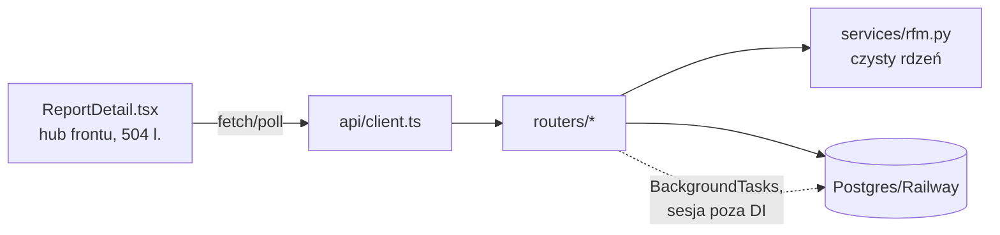

# Mapa projektu — EventPulse Web

> Synteza artefaktów 1–3 (`artifact-1-territory.md`, `artifact-2-structure.md`,
> `artifact-3-contributors.md`). Krótka i decyzyjna: do użycia przez agenta na starcie
> sesji w tym repo. Stan na 2026-09-11.

## Czym to jest

RFM customer segmentation: FastAPI + Python 3.13 (root) + Vite/React 19 SPA (`frontend/`),
Postgres na Railway, JWT auth. ~2000 linii kodu produktu, 42 commity, solo autor.
MVP ukończone (roadmapa S-01…S-05 done), produkcja działa na Railway.

## Architektura w trzech zdaniach

Backend w czterech warstwach bez cykli: `main.py` (rejestracja) → `routers/` (HTTP +
kontrakty Pydantic inline + ownership filter) → `models/` (ORM) + `services/rfm.py`
(czysty algorytm) + `database.py` (engine/sesje). Frontend: cienki `api/client.ts` →
strony z lokalnym stanem; globalny store tylko dla auth. Analiza RFM działa asynchronicznie
przez FastAPI BackgroundTasks ze statusem `created → analyzing → completed/failed`
pollowanym przez frontend.

## Strefy ryzyka

1. **Przepływ analizy** (`routers/analysis.py` + `services/rfm.py` + `models/report.py`) —
   rdzeń biznesowy; background task otwiera sesję **poza DI** (`get_session_factory()()`),
   co już raz ugryzło testy (lessons.md). Zmiany tu pociągają 4 pliki naraz (co-change,
   artifact-1). Najtwardszy coupling w repo.
2. **`routers/events.py` (378 l.)** — parsowanie CSV/JSON, walidacja i cap 200k inline
   w warstwie HTTP; najgęstszy plik backendu, 4 rundy zmian w historii.
3. **`ReportDetail.tsx` (504 l.)** — frontendowy god-component: upload, generator,
   run-analysis, polling i tabela wyników w jednym; dotykany przez 5 z 7 zmian produktowych.
4. **`database.py` + Railway** — jedyne produkcyjne hotfixy w historii (URL asyncpg,
   `pool_pre_ping`); wrażliwe na środowisko, słabo testowalne lokalnie.
5. **Ownership filter jako konwencja** — `Report.user_id == current_user.sub` kopiowany
   ręcznie per endpoint; brak mechanizmu, który wymusi go w nowym kodzie.

## Pierwszy dzień (entry pointy do czytania)

1. `main.py` — 46 linii, cała topologia aplikacji.
2. `routers/analysis.py` — najciekawszy przepływ: HTTP → background task → `compute_rfm` → zapis.
3. `frontend/src/pages/ReportDetail.tsx` — całe UI produktu w jednym pliku.
Dalej wg potrzeby: `services/rfm.py` (algorytm), `tests/conftest.py` (jak testuje się to repo).

## Ograniczenia (unknowns do potwierdzenia przed większą zmianą)

- **Zachowanie BackgroundTasks przy awarii procesu** — czy raport w statusie `analyzing`
  może utknąć na zawsze (deploy/restart Railway w trakcie analizy)? Nieprzetestowane.
- **Transakcyjność uploadu** — czy odrzucenie rekordu w środku pliku zostawia częściowy
  zapis? Kontrakt mówi „nie", test tego wprost nie przybija (test-plan.md Risk #3).
- **Wydajność przy górnej granicy 200k eventów** — NFR 30 s nigdy nie zmierzony.
- **Frontend bez testów przepływów** — 2 pliki testów utili/slice; każda zmiana
  `ReportDetail.tsx` jest weryfikowana ręcznie (test-plan.md Risk #4).

## Konwencje, których pilnować

Pydantic na każdej granicy API (AGENTS.md) · ownership filter w każdym endpointcie zasobowym ·
`safeJsonParse` dla localStorage · lint frontu przed commitem · artefakty zmian w
`context/changes/<id>/` (change → research → plan → implement), lekcje w
`context/foundation/lessons.md`.
